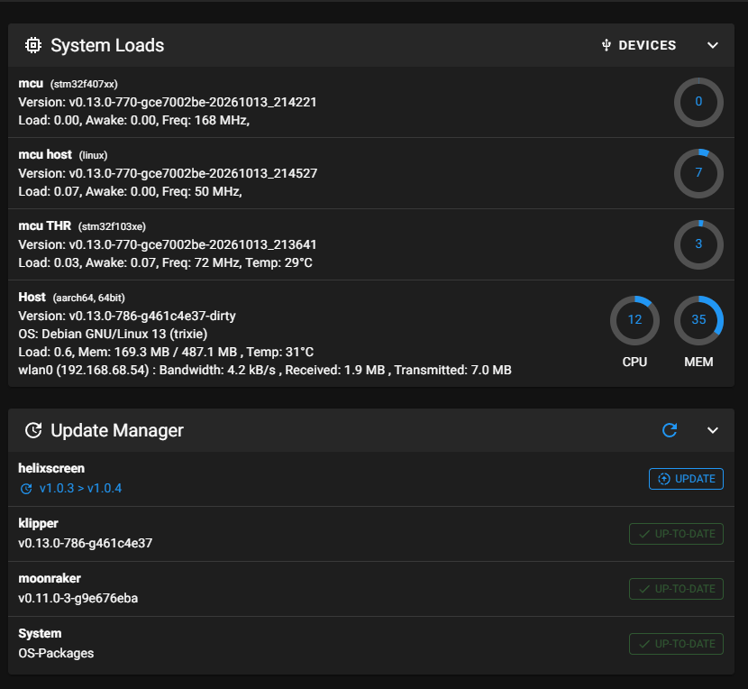
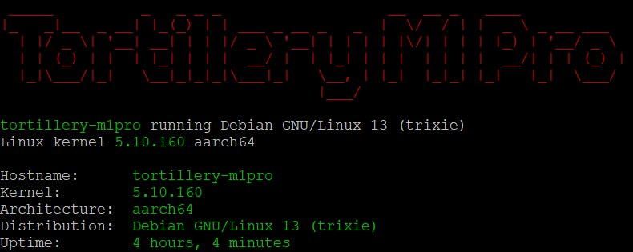

# Tortillery-M1Pro

**Custom firmware for the Artillery M1 Pro**  
**Beta — Work in Progress**

   

> [!IMPORTANT]
> **This project is under active development.** Tortillery-M1Pro is currently functional, but its macros and configuration settings still require review, testing, and fine-tuning. It is **not a stable or final release**.

## Overview

**Tortillery-M1Pro** is a custom firmware project for the **Artillery M1 Pro** 3D printer, based on **Debian GNU/Linux 13 (Trixie)** and **Klipper v13**.

The current beta has working support for the **CS1237 probe** and **cutter sensor**. Scripts for flashing the **Host, Main, and THR MCUs** are also available. The **AI camera is not currently active**.

## Current Feature Status

| Component | Status | Details |
| --- | --- | --- |
| Debian GNU/Linux 13 (Trixie) | ✅ Running | Firmware operating system |
| Klipper v13 | ✅ Running | Printer control software |
| CS1237 probe | ✅ Working | Probe functionality operational |
| Cutter sensor | ✅ Working | Sensor functionality operational |
| Host MCU flashing | ✅ Available | Flashing script included in the download folder |
| Main MCU flashing | ✅ Available | Flashing script included in the download folder |
| THR MCU flashing | ✅ Available | Flashing script included in the download folder |
| AI camera | ⏸️ Inactive | Not enabled in the current beta |
| Macros and settings | 🔧 Needs refinement | Further review and adjustment required |

## Download

### 📥 Firmware and Flashing Tools

**[Download Tortillery-M1Pro firmware and tools from Google Drive](https://drive.google.com/drive/folders/1FenMh4RXV9PXNuyFfsBMxAcPvBawfPU2?usp=sharing)**

The download folder contains:

- Tortillery-M1Pro custom firmware
- MCU flashing scripts for **Host**, **Main**, and **THR**
- **RKDevTool**
- **Windows drivers**

> [!WARNING]
> This is **beta firmware**. Flashing firmware carries a risk of data loss, device malfunction, or requiring recovery. Back up your current firmware and printer configuration where possible, verify hardware compatibility, and review the flashing files before proceeding. Use at your own risk.

## Screenshots

Screenshots from the current Tortillery-M1Pro beta environment.

### System Loads and Update Manager

System status showing Host, Main and THR MCUs, Klipper, Debian GNU/Linux 13 (Trixie), and the update manager.

### Terminal System Information

Tortillery-M1Pro terminal banner, Linux kernel version, architecture, and Debian 13 (Trixie) environment.

## Development Status

**Overall status: Functional beta — further testing and tuning required.**

- [x] Debian GNU/Linux 13 (Trixie) running
- [x] Klipper v13 running
- [x] CS1237 probe working
- [x] Cutter sensor working
- [x] MCU flashing scripts available for Host, Main, and THR
- [ ] Review and validate macros
- [ ] Refine printer configuration and settings
- [ ] Complete further beta testing

### Known Limitations

- Macros still require review and testing.
- Configuration settings still need adjustments and fine-tuning.
- The AI camera is **not active** in the current version.

## Compatibility

This firmware is intended for the **Artillery M1 Pro**. Compatibility with other Artillery printer models has **not been established**.

## Support and Feedback

Questions, bug reports, testing feedback, and contributions are welcome.

💬 **[Contact the project on Telegram](https://t.me/+9mpIxyQTtlQ2NmQ8)**

You can also open a GitHub issue in this repository to report a problem or suggest an improvement once the repository is published.

## License and Credits

Tortillery is an independent community project for the Artillery M1 Pro.

This project is based on and includes modifications to:

- **Klipper** — [Klipper3d/klipper](https://github.com/Klipper3d/klipper) — GNU GPL v3.0
- **Katapult** — [Arksine/katapult](https://github.com/Arksine/katapult) — GNU GPL v3.0
- **Qidi Q2 Mainline Klipper**, developed by **Ahmed Sheikh (MisterSheikh)** — [MisterSheikh/Qidi_Q2_Mainline_Klipper](https://github.com/MisterSheikh/Qidi_Q2_Mainline_Klipper) — GNU GPL v3.0

The GD32F425 USB compatibility patches are based on work by Ahmed Sheikh. Tortillery includes additional Artillery M1 Pro configurations, build and flashing scripts, documentation, and CS1237 adjustments.

Original copyright notices and applicable open-source licenses are retained. The corresponding firmware source code and modifications are provided with the build kit linked in the [Download](#download) section.

See [LICENSE](LICENSE) for the GNU General Public License version 3.

Tortillery is not officially affiliated with or endorsed by Artillery, Klipper, Katapult, Makerbase/MKS, or MisterSheikh.

---

*Made for the Artillery M1 Pro community. Tortillery-M1Pro is an independent custom firmware project currently in beta development.*
